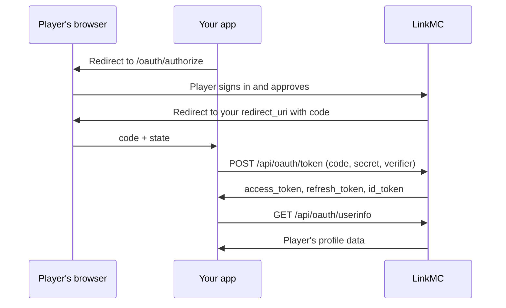

# Sign in with LinkMC

LinkMC is an OAuth 2.0 and OpenID Connect provider. Your app can use it to let players sign
in with their Minecraft account and to read the profile data that they agree to share.

## Before you begin

1. Sign in to LinkMC.
1. Go to **Settings** > **Applications**, and then create an application.
1. Add every redirect URI that your app uses. LinkMC only redirects to an exact match.
1. Copy the client secret and store it securely. LinkMC shows it only once.

Each account can have up to 10 applications. If your secret leaks, rotate it in
**Settings** > **Applications**. Rotating the secret also revokes every token that the app
holds.

## How sign-in works



## Step 1: Send the player to LinkMC

Redirect the player's browser to:

```
https://linkmc.app/oauth/authorize?response_type=code&client_id=CLIENT_ID&redirect_uri=REDIRECT_URI&scope=SCOPES&state=STATE&code_challenge=CHALLENGE&code_challenge_method=S256
```

| Parameter | Description |
|---|---|
| `response_type` | `code`. |
| `client_id` | Your application's client ID. |
| `redirect_uri` | One of your registered redirect URIs, URL-encoded. |
| `scope` | Space-separated [scopes](#scopes). `identity` is always included. |
| `state` | A random value that you check when the player returns. |
| `code_challenge` | Recommended. The PKCE challenge: the base64url-encoded SHA-256 hash of your code verifier. |
| `code_challenge_method` | `S256` (recommended) or `plain`. |
| `nonce` | Optional. With the `openid` scope, LinkMC copies it into the ID token. |

The player signs in if they need to, and then approves or denies your request. LinkMC then
redirects to your `redirect_uri`:

- **Approved:** `REDIRECT_URI?code=CODE&state=STATE`
- **Denied:** `REDIRECT_URI?error=access_denied&state=STATE`

Check that `state` matches the value that you sent. The code expires after 10 minutes and
works once.

## Step 2: Exchange the code for tokens

From your server, send a `POST` request to `https://linkmc.app/api/oauth/token`. The body can
be form-encoded or JSON.

| Field | Value |
|---|---|
| `grant_type` | `authorization_code` |
| `code` | The code from step 1. |
| `redirect_uri` | The same redirect URI as in step 1. |
| `client_id` | Your client ID. |
| `client_secret` | Your client secret. |
| `code_verifier` | Your PKCE code verifier, if you sent a challenge. |

```json
{
  "access_token": "lmcat_…",
  "token_type": "Bearer",
  "expires_in": 3600,
  "refresh_token": "lmcrt_…",
  "scope": "identity identity:skin",
  "id_token": "eyJ…"
}
```

`id_token` is included when you request the `openid` scope. It's signed with RS256; get the
public keys from the JWKS endpoint listed in [Discovery](#discovery).

> [!CAUTION]
> Never put your client secret in a browser, a mod, or any other code that players can
> download.

## Step 3: Get the player's data

Send the access token to the userinfo endpoint:

```
GET https://linkmc.app/api/oauth/userinfo
Authorization: Bearer ACCESS_TOKEN
```

The response contains the claims for the scopes that the player approved:

```json
{
  "sub": "069a79f4-44e9-4726-a5be-fca90e38aaf5",
  "mc_uuid": "069a79f4-44e9-4726-a5be-fca90e38aaf5",
  "mc_username": "Notch",
  "linkmc_profile": "https://linkmc.app/profile/Notch",
  "skin": {
    "face_url": "https://linkmc.app/api/profiles/…/skin/2d/face",
    "raw_url": "https://linkmc.app/api/profiles/…/skin/raw",
    "variant": "CLASSIC"
  }
}
```

## Refresh an access token

Access tokens last one hour. To get a new one, send a `POST` request to the token endpoint
with `grant_type=refresh_token`, `refresh_token`, `client_id`, and `client_secret`.

Refresh tokens last 90 days. Each refresh returns a new refresh token, and the old one stops
working, so always store the newest one.

## Revoke and inspect tokens

| Endpoint | Description |
|---|---|
| `POST /api/oauth/token/revoke` | Revokes an access or refresh token ([RFC 7009](https://www.rfc-editor.org/rfc/rfc7009)). Send `token`, `client_id`, and `client_secret`. |
| `POST /api/oauth/token/introspect` | Reports whether a token is active, and its scopes and expiry ([RFC 7662](https://www.rfc-editor.org/rfc/rfc7662)). Send the same fields. |

Players can also revoke your app's access at any time on LinkMC.

## Scopes

| Scope | Claims | Description |
|---|---|---|
| `identity` | `sub`, `mc_uuid`, `mc_username`, `linkmc_profile` | Always included. |
| `openid` | ID token | Signs the player in with OpenID Connect. |
| `identity:skin` | `skin` | Skin texture and render URLs, and the skin model. |
| `minecraft:name_history` | `name_history` | Past usernames. |
| `profile:verified` | `verified`, `badge`, `extra_flag` | Verified status and badge. |
| `profile:member_since` | `member_since` | When the player joined LinkMC. |
| `profile:email` | `contact_email`, `email_source` | The player's contact email. Sensitive. |
| `social:PLATFORM` | `socials` | The player's handle on one platform: `instagram`, `twitch`, `tiktok`, `spotify`, `modrinth`, `gitlab`, `youtube`, `github`, or `bluesky`. |
| `servers:joined` | `servers_joined` | Servers that the player joined on LinkMC. |
| `servers:owned` | `servers_owned` | Servers that the player owns. |
| `servers:visited` | `servers_visited` | Servers that the player has visited. |
| `servers:private` | — | Adds the player's hidden memberships to the server scopes. Sensitive. |
| `presence` | `presence` | Whether the player is on a listed server right now, and which one. |
| `im:discord` | `im_discord` | Discord username and user ID, even if the player hides Discord on their profile. Sensitive. |
| `im:fluxer` | `im_fluxer` | Fluxer username and user ID, even if the player hides Fluxer on their profile. Sensitive. |

Request only the scopes that your app needs. The consent screen lists each scope, and
players are more likely to approve short lists. To get the scope list from the API, call
`GET /api/oauth/scopes`.

## Discovery

OpenID Connect clients can configure themselves from
`https://linkmc.app/.well-known/openid-configuration`. Signing keys are at
`https://linkmc.app/.well-known/jwks.json`.

LinkMC supports the authorization code grant only, with the client secret sent in the
request body (`client_secret_post`).

## Rate limits

The token and authorization endpoints accept up to 30 requests a minute from each IP
address. Requests over the limit get `429 Too Many Requests`.
