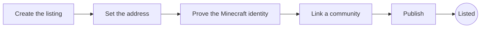

# List your server

LinkMC lists Minecraft servers whose owners prove that they run them. Every listed server must
follow the [Servers Code of Conduct](server-code-of-conduct.md). This page explains how
to list your server, prove that it's yours, and manage it with your staff.

## Requirements

Your server appears on LinkMC when it meets all three requirements:

1. **Address:** You set the address that players use to connect.
1. **Minecraft identity:** You prove that you control the server with the
   [Bridge plugin or mod](#use-the-bridge-plugin-or-mod), a [DNS record](#add-a-dns-record),
   or a [MOTD code](#add-a-motd-code).
1. **Community:** You link a Discord server that has the LinkMC bot in it. Fluxer and Stoat
   support is coming.

You can click **Publish** at any time. Your server goes live as soon as it meets every
requirement. If it later stops meeting one, for example because you removed the DNS record or
kicked the bot, LinkMC hides the server until you fix it.

## Create a listing

1. Sign in to LinkMC.
1. Go to **Servers**, and then click **Add your server**.
1. Enter your server's name and address.

You become the server's owner. The server's console shows a checklist of the remaining
requirements.

## Prove the Minecraft identity

Choose one method. You can add more than one.

### Use the Bridge plugin or mod

1. In the console, go to **Identity**, and then create a credential.
1. Copy the client ID and private key. LinkMC shows the private key only once.
1. Install the LinkMC Bridge plugin or mod, and then start the server once to create its
   configuration file.
1. Paste the client ID and private key into the configuration file, and then restart the
   server.

| Software | Configuration file |
|---|---|
| Paper, Spigot, or Folia | `plugins/LinkMC/config.yml` |
| BungeeCord or Waterfall | `plugins/LinkMC/config.yml` |
| Velocity | `plugins/linkmc/config.toml` |
| Fabric or Quilt | `config/linkmc.toml` |
| Forge or NeoForge | `config/linkmc-common.toml` |

The server is verified when the plugin first connects. You can label and revoke credentials
in the console. To build your own integration, see the [Plugin API](plugin-api.md).

### Add a DNS record

In the console, go to **Identity**, choose a record type, and then add the record that the
console shows to your domain's DNS:

| Record | Name | Value | Proves |
|---|---|---|---|
| TXT | `_linkmc.play.example.com` | `linkmc-verify=CODE` | That one host. |
| CNAME | `_linkmc-srv-challenge.example.com` | `CODE.challenge.linkmc.app` | The domain and all of its subdomains. |

LinkMC checks the record every day. The code changes every 90 days, and the old code keeps
working for 14 days after that, so you have time to update the record.

### Add a MOTD code

LinkMC pings your server's address the same way that the Minecraft server list does, and
looks for a code like `LMC-ABCXY` at the end of your MOTD. The code is obfuscated with `§k`,
so players don't see it. It proves that exact address and port for 28 days. If the code is
still in your MOTD near the end of that time, LinkMC renews it automatically.

In the console, go to **Identity**, choose your server software, and then follow the steps
for it:

- **Vanilla, Paper, or Spigot:** In `server.properties`, add
  `§2§kLMC-ABCXY§r` to the end of `motd=`, and then restart the server.
  `server.properties` doesn't support `&` color codes.
- **MiniMOTD:** Paste your `motds` block into the console. The console adds an entry with
  `line2="<reset><color:#0c6b42><obf>LMC-ABCXY<reset>"`. Run `/minimotd reload`, and keep the
  entry in your rotation so that the code renews.
- **BungeeCord or Waterfall:** Add `&x&R&R&G&G&B&B&kLMC-ABCXY` to the end of `motd` in
  `config.yml`. The console shows your server's color.
- **Velocity:** Add `<#RRGGBB><obf>LMC-ABCXY` to the end of `motd` in `velocity.toml`, and
  then run `velocity reload`.

For MiniMOTD, BungeeCord, and Velocity, LinkMC also checks the color.

## Link a community

1. In the console, go to **Community**, and then choose the platform. Your account on that
   platform must be linked to LinkMC, and you need the **Administrator** permission in the
   community.
1. Add the LinkMC bot with the invite link that the console shows.
1. In the community, run `/lmc link CODE`. The code works once and expires after five
   minutes.

Each server can link one community on each platform. For the bot's settings, see
[Community bot](community-bot.md).

## Manage staff

| Role | Permissions |
|---|---|
| Moderator | Review applications, manage members, and read the audit log. |
| Admin | Everything a moderator can do, plus edit the listing, identity, credentials, community, and moderators. |
| Owner | Everything an admin can do, plus manage admins, transfer ownership, and delete the server. |

Staff need a LinkMC account. The audit log records every change.

Before you transfer ownership or delete a server, LinkMC asks you to confirm that it's you,
with a passkey or by signing in again. The confirmation lasts five minutes.

## Moderation by LinkMC staff

LinkMC staff can take content down on any server, but they can't make changes for you.
They can remove a server's name, description, icon, tags, or game modes, unlink a community,
remove members or staff other than the owner, and suspend the server. Each of these actions
appears in your audit log.

## Rich presence

Players who use the [LinkMC mod](rich-presence.md) show **Playing on** and your server's
name and icon in their Discord and Fluxer status and on their LinkMC profile. LinkMC never shows
your server's address there. This works only while your server is listed, and only for players
who connect with the exact address of your listing.

To turn it off, clear **Show this server in players' rich presence** under **Listing** in your
server's console. Players on your server then show **Multiplayer**.

## Uptime

LinkMC checks each listed server about once a minute. If your server runs the Bridge plugin
or mod, its regular report counts as the check. Your server's status page shows the results:

| Color | Uptime |
|---|---|
| Green | 99% or more |
| Yellow | 90% to 99% |
| Orange | 50% to 90% |
| Red | Under 50% |
| Gray | No data |

LinkMC keeps 14 days of history. The history starts over when you change the server's
address or port.
