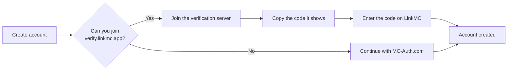

# Get started

LinkMC is a free identity platform for Minecraft: Java Edition players. You prove that you
own a Minecraft account once, and LinkMC gives you a public profile that shows your skin,
your linked accounts, and the servers you play on.

This page explains how to look up players, create an account, and set up your profile.

## Look up a player

You don't need an account to look up a player. Every Minecraft: Java Edition player has a
profile page, whether or not they use LinkMC:

```
https://linkmc.app/profile/USERNAME
https://linkmc.app/profile/UUID
```

Replace `USERNAME` with the player's current username, or `UUID` with their Minecraft UUID.
Both forms show the same page. To look up players from your own code, see the
[API reference](api-reference.md).

## Create an account

To create an account, prove that you own your Minecraft account. LinkMC never sees your
Microsoft password.



### Use the verification server

1. On LinkMC, click **Sign in**, and then click **Create account**.
1. Select both checkboxes to confirm your age and accept the terms.
1. In Minecraft: Java Edition, add `verify.linkmc.app` as a server and join it.

   The server disconnects you right away and shows a code like `ABC-XYZ-123`. You don't
   load into a world.
1. On LinkMC, enter the code within 60 seconds.

Each code works once and only for your Minecraft account. If your code expires, join the
server again to get a new one.

> [!IMPORTANT]
> The verification server accepts IPv6 connections only for now. If the login page says
> your network doesn't support IPv6, use MC-Auth.com instead.

### Use MC-Auth.com

MC-Auth.com is a third-party service that verifies your Minecraft account on its own site
and then returns you to LinkMC.

1. On the **Create account** page, select both checkboxes.
1. Click the **MC-Auth.com** tab, and then click **Continue with MC-Auth.com**.
1. Follow the steps on MC-Auth.com.

> [!NOTE]
> Sign-in with a Microsoft account is coming soon. For dates, see the [Roadmap](roadmap.md).

## Sign in

After you create an account, you can sign in with any of these methods:

| Method | What you need |
|---|---|
| Passkey | A passkey that you added in **Settings** > **Security**. |
| Discord or Fluxer | A Discord or Fluxer account that's linked to LinkMC, with sign-in turned on in **Settings** > **Security**. |
| Verification server | A Minecraft account that can join `verify.linkmc.app`. |
| MC-Auth.com | Your MC-Auth.com sign-in. |

## Secure your account

Add a passkey so that you can sign in without the verification server:

1. Go to **Settings** > **Security**.
1. Click **Add a passkey**, and then follow your browser's prompts.

## Link your other accounts

Linked accounts appear on your profile, and they let Discord communities verify you. To link
an account, go to your **Dashboard** and click the account that you want to link.

| Account | How LinkMC confirms it |
|---|---|
| Discord | Discord sign-in |
| Fluxer | Fluxer sign-in |
| GitHub | GitHub sign-in |
| GitLab | GitLab sign-in |
| YouTube | Google sign-in |
| Bluesky | Bluesky sign-in |

When you link Discord or Fluxer, LinkMC asks for these permissions:

| Permission | Why LinkMC asks for it |
|---|---|
| `identify` | Your username and user ID. |
| `email` | Lets you use this address as your contact email. |
| `connections` | The accounts that you connected to Discord or Fluxer. |
| `guilds` | Shows which communities you share with other players, and lets server communities verify you. |

You can unlink an account at any time on the **Dashboard**. Unlinking removes the account
from your profile right away.

## Customize your profile

- **Player card accounts:** On the **Dashboard**, choose up to four accounts to show on your
  player card and in link previews.
- **Name style and theme:** In **Settings** > **Theme & Profile**, choose a name gradient and
  a site theme.
- **Social handles:** In **Settings** > **Social Settings**, add your Instagram, Twitch,
  TikTok, Spotify, and Modrinth handles.
- **Contact email:** In **Settings**, choose which email address LinkMC uses to contact you
  about your account.

## What's next

- [List your server](server-listing.md)
- [Add the community bot to your Discord server](community-bot.md)
- [Use the LinkMC API](api-reference.md)
- [Let players sign in to your app with LinkMC](oauth.md)
