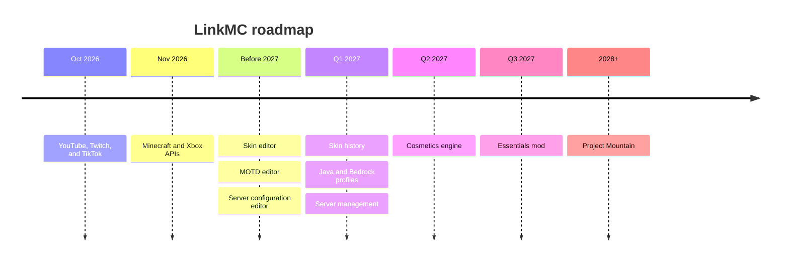

# Roadmap

This page lists the features that LinkMC plans to build. Dates are targets, not promises,
and they can change.

## Planned features

| Target | Feature |
|---|---|
| End of October 2026 | **YouTube, Twitch, and TikTok integration.** Link these accounts and show them on your profile. |
| End of November 2026 | **Direct Minecraft and Xbox integration.** Connect to the Minecraft and Microsoft Xbox APIs directly. |
| Before 2027 | **Skin editor.** Edit your skin on LinkMC. |
| Before 2027 | **MOTD editor.** Design your server's message of the day. |
| Before 2027 | **Server configuration editor.** Edit your server's configuration files from LinkMC. |
| Q1 2027 | **Skin history.** See every skin that a player has used. |
| Q1 2027 | **Merged Java and Bedrock profiles.** Add your Bedrock Edition account to your Java Edition profile. |
| Q1 2027 | **Server management for self-hosters.** Manage your server instances from the web or a desktop app. |
| Q2 2027 | **Cosmetics engine.** LinkMC's own cosmetics. |
| Q3 2027 | **Essentials mod.** World hosting, friends, messaging, and parties, with no pushed microtransactions. |
| Ongoing | **Profile customization.** More ways to customize your profile. |
| 2028 or later | **Project Mountain.** A Minecraft: Java Edition client. This project is under consideration. |

> [!NOTE]
> A profile always starts from a Java Edition account. You can't create a profile for a
> Bedrock Edition account on its own.

## Suggest a feature

To suggest a feature or report a bug, use **Settings** > **Bug Reporting**, or join the
LinkMC Discord server from the link in the site footer.
